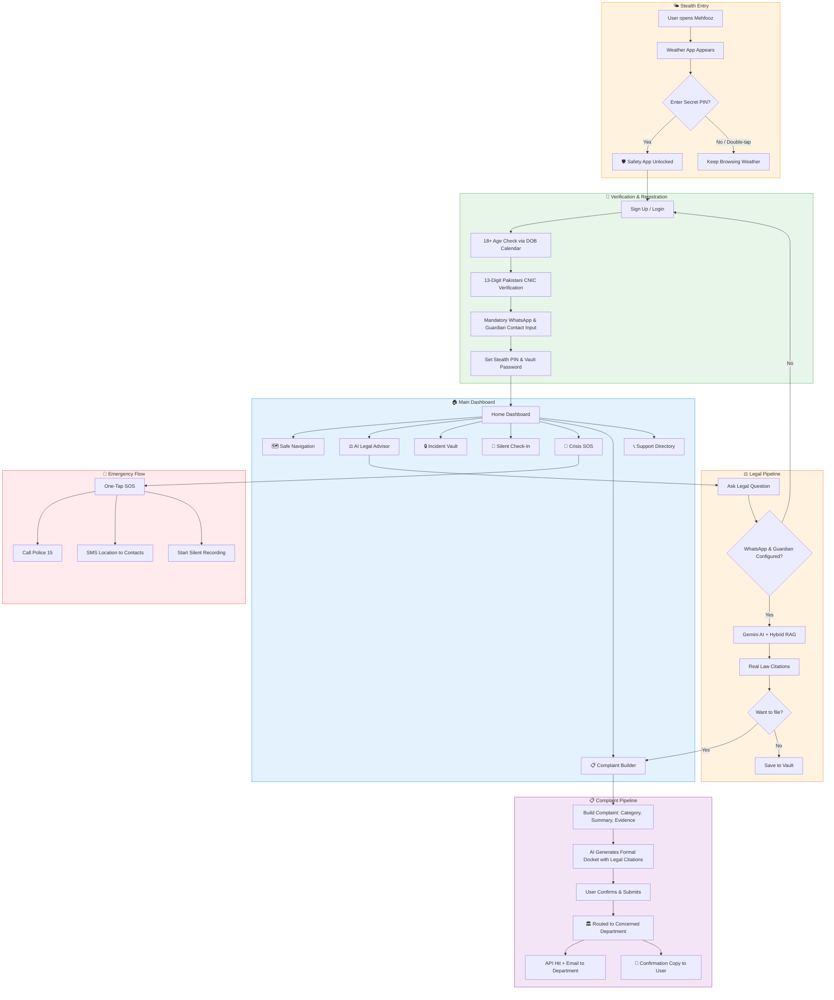
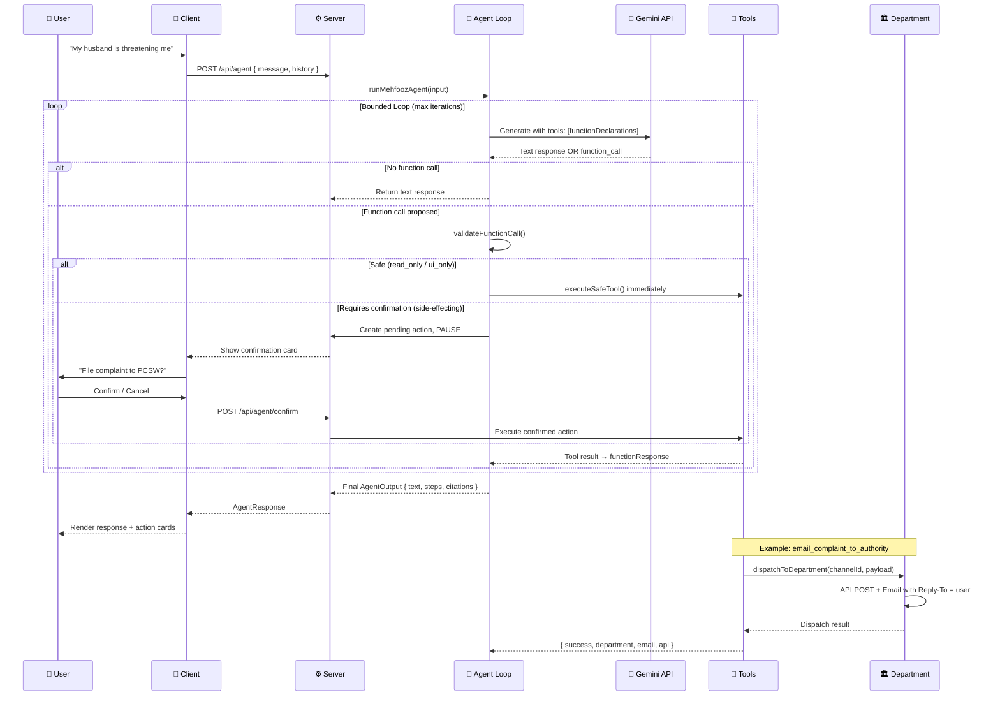
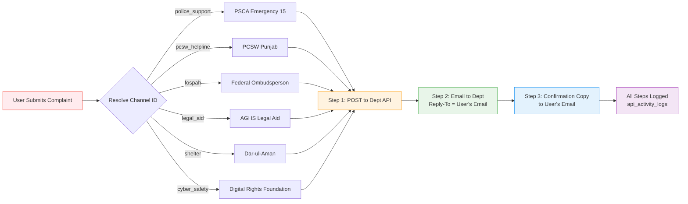

<div align="center">

<!-- ═══════════════════════════════════════════════════════════════════════ -->
<!-- ANIMATED HEADER                                                        -->
<!-- ═══════════════════════════════════════════════════════════════════════ -->


<br>

<!-- ── Status Badges ─────────────────────────────────────────────────── -->
<a href="https://mehfooz-legal-navigator.vercel.app">
  
</a>


<a href="https://github.com/MudassarAbrar/MehfoozAi/issues">
  
</a>


<br><br>

**مehfooz — محفوظ** | A privacy-first women's safety & legal assistant for Punjab, Pakistan

*Opens as a weather app. Protects like a guardian.*

<a href="https://mehfooz-legal-navigator.vercel.app"><strong>🚀 Try Live Demo</strong></a> •
<a href="#-what-mehfooz-does"><strong>📖 Learn More</strong></a> •
<a href="#-quick-start"><strong>⚡ Quick Start</strong></a> •
<a href="#-team"><strong>👥 Team</strong></a>

<br><br>

</div>

---

## 📑 Table of Contents

- [What Mehfooz Does](#-what-mehfooz-does)
- [The Problem We Solve](#-the-problem-we-solve)
- [User Flow](#-user-flow)
- [User Verification & Protection Controls](#-user-verification--protection-controls)
- [Six Safety Pillars](#-six-safety-pillars)
- [System Architecture](#-system-architecture)
- [Visual Architecture & System Flow Diagrams](#-visual-architecture--system-flow-diagrams)
- [Agentic AI System](#-agentic-ai-system)
- [Department Routing — How Complaints Reach Authorities](#-department-routing--how-complaints-reach-authorities)
- [Community Safety Network & Corroboration Engine](#-community-safety-network--corroboration-engine)
- [Silent Check-In & Autonomous Escalation Protocol](#-silent-check-in--autonomous-escalation-protocol)
- [OpenStreetMap Real-Time Safe Navigation](#-openstreetmap-real-time-safe-navigation)
- [Court-Admissible Legal Complaint Docket & PDF Generator](#-court-admissible-legal-complaint-docket--pdf-generator)
- [API Reference](#-api-reference)
- [Tech Stack](#-tech-stack)
- [Project Structure](#-project-structure)
- [Women's Safety Legal Corpus & Primary Source Documents](#-womens-safety-legal-corpus--primary-source-documents)
- [Quick Start](#-quick-start)
- [Environment Variables](#-environment-variables)
- [Deployment](#-deployment)
- [Team](#-team)
- [Contact & Socials](#-contact--socials)

---

## 🛡️ What Mehfooz Does

Mehfooz (مehfooz — "protected" in Urdu) is a **mobile web application** designed for women in Punjab, Pakistan. It provides a complete safety ecosystem disguised as a weather app — so anyone looking at your phone sees a beautiful weather interface, not a safety tool.

**Enter your secret PIN → the real app appears.**

| Feature | What It Does |
|---|---|
| 🌤️ **Stealth Weather Cover** | Opens as a weather app. No one knows it's your safety shield. |
| 🗺️ **Safe Corridor Navigation** | Finds the safest walking route — well-lit streets, CCTV zones, busy areas. |
| ⚖️ **AI Legal Advisor** | Ask legal questions in English or Urdu. Get real Punjab law citations. |
| 🔒 **Zero-Knowledge Vault** | Record evidence (voice, photos, timelines) encrypted on YOUR phone. |
| 📍 **Silent Check-In** | Set a journey timer. If you don't arrive, contacts get your live location. |
| 🚨 **One-Tap SOS** | Calls Police 15 + SMS your location to trusted contacts simultaneously. |
| 📋 **Complaint Builder** | Generates formal police complaints with legal citations, routed to the right department. |
| 📴 **100% Offline Mode** | Emergency numbers, legal rights, and SOS work with zero internet. |

---

## 💔 The Problem We Solve

> **52% of women in Pakistan experience some form of violence in their lifetime.** *(National Assembly of Pakistan, 2018)*

Women in Punjab face a dangerous gap between **threats** and **help**:

```
┌──────────────────────────────────────────────────────────────────────┐
│  THE GAP                                                              │
│                                                                       │
│  🚫 Street harassment      →  "Who do I call?"                       │
│  🚫 Domestic violence       →  "What are my legal rights?"            │
│  🚫 Cyber bullying          →  "How do I file a complaint?"           │
│  🚫 Walking home at night   →  "Is this route safe?"                  │
│  🚫 No internet / signal    →  "Emergency services are unreachable"   │
│  🚫 Abuser has your phone   →  "All my evidence is gone"              │
│                                                                       │
│  Mehfooz bridges this gap. One app. Six pillars. Zero compromise.    │
└──────────────────────────────────────────────────────────────────────┘
```

### Use Cases

| Scenario | How Mehfooz Helps |
|---|---|
| Walking home late at night | Safe Corridor Navigation finds well-lit, camera-covered routes |
| Receiving threatening messages | AI Legal Advisor explains PECA 2016 cyber harassment protections |
| Domestic violence at home | One-tap SOS to Police 15 + silent audio recording |
| Evidence at risk of deletion | Zero-Knowledge Vault encrypts photos & voice with your PIN |
| No mobile data / signal dropped | Offline mode — cached helplines, legal articles, SMS SOS still work |
| Need to file a police complaint | Complaint Builder generates formal docket, routes to the right department |
| Traveling alone — family worried | Silent Check-In auto-alerts contacts if you don't arrive on time |
| Abuser finds your phone | App looks like a weather widget — PIN unlocks the real features |

---

## 🔄 User Flow



---

## 🔐 User Verification & Protection Controls

To safeguard women, protect evidence integrity, and ensure compliance with statutory requirements, Mehfooz enforces automated safety and identity controls:

| Security Control | Implementation | How It Works & Rationale |
|---|---|---|
| 📅 **18+ Age Verification** | Date of Birth Calendar Picker | Replaced manual numeric input with an HTML5 date picker. The system dynamically computes `calculateAge(dob)` on change. If under 18 years old, submission is prohibited with clear bilingual feedback. |
| 🪪 **Pakistani CNIC Check** | 13-Digit Format Verification | Stripped all dummy prefilled credentials. Enforces live auto-hyphenation (`XXXXX-XXXXXXX-X`) and validates that exactly 13 digits are provided. |
| 📱 **Mandatory WhatsApp / Safe Phone** | Valid Mobile Verification | Elevated from optional to strictly mandatory. Required for automated emergency dispatch, journey updates, and safe contact syncing. |
| 👥 **Mandatory Guardian / Emergency Contact** | Contact Name & Verified Phone | Mandatory for account creation. Critical for automated SOS broadcasts and missed check-in escalation. |
| 💬 **Chat Access Gating** | Pre-Chat Contact Verification | The AI Legal Assistant checks for active safe phone and emergency contact numbers before initiating conversations. A visible prompt guides users to complete details if missing. |
| 📱 **Full-Bleed PWA Adaptive Icons** | 100% Canvas Maskable Bleed | Removed transparent margin padding from `pwa-maskable-512x512.png` and `icon.svg` so Android and iOS launchers render crisp, edge-to-edge icons without white borders or blank spaces. |


---

## 🏛️ Six Safety Pillars

| # | Pillar | Module | Description |
|---|---|---|---|
| 1 | 🌤️ Stealth Cover | `WeatherCover.tsx` | Authentic weather interface — PIN unlocks the safety ecosystem |
| 2 | 🗺️ Safe Navigation | `SafeNavigation.tsx` | Leaflet/OSM maps with safety-scored pedestrian corridors |
| 3 | ⚖️ Legal Advisor | `LegalAssistant.tsx` | Voice-enabled AI chat grounded on 34 Punjab protection laws |
| 4 | 🔒 Incident Vault | `IncidentVault.tsx` | AES-GCM-256 encrypted evidence locker (voice, photos, timelines) |
| 5 | 📍 Silent Check-In | `SilentCheckIn.tsx` | Destination timer — auto-alerts contacts if you don't arrive |
| 6 | 🚨 Crisis SOS | `CrisisModal.tsx` | One-tap dispatch to Police 15, PCSW 1043, Rescue 1122 |

---

## 🏗️ System Architecture

```mermaid
graph TB
    subgraph CLIENT["📱 Client — React 19 SPA"]
        direction TB
        UI[React Components<br/>Tailwind CSS v4 + motion/react]
        VOICE[Web Speech API<br/>SpeechRecognition + SpeechSynthesis]
        CRYPTO[Web Crypto API<br/>AES-GCM-256 Vault]
        MAP[Leaflet + OpenStreetMap<br/>Safe Corridor Routing]
        PWA[PWA Service Worker<br/>Offline Cache + Icons]
        STATE[ChatStateProvider<br/>Cross-Tab Conversation Persistence]
    end

    subgraph SERVER["⚙️ Server — Express on Vercel Serverless"]
        direction TB
        API[Express API Routes<br/>/api/orchestrate, /api/complaint-handoff, ...]
        AGENT[Gemini AI Agent<br/>Function-Calling Loop<br/>Bounded Execution + Confirmation Gates]
        RAG[Hybrid Retriever<br/>60% Gemini Embeddings + 40% Keyword Scoring]
        DEPT[Department Router<br/>9 Departments → API + Email Dispatch]
        AUTH[Supabase Auth<br/>JWT + RLS User Context]
        EMAIL[Resend Email SDK<br/>XSS-Escaped Complaint Templates]
        SMS[Twilio SMS<br/>Emergency Dispatch]
        CHECKIN[Check-In Monitor<br/>Supabase pg_cron Edge Function]
        SECURITY[Helmet + Rate Limiting<br/>CSP + Input Sanitization]
    end

    subgraph EXTERNAL["🌐 External Services"]
        direction TB
        GEMINI[Google Gemini API<br/>gemini-2.5-flash + gemini-embedding-2]
        SUPABASE[(Supabase<br/>PostgreSQL + RLS + Edge Functions)]
        RESEND[Resend<br/>Transactional Email]
        TWILIO[Twilio<br/>SMS Gateway]
        OSM[OpenStreetMap / Nominatim<br/>Geocoding + Routing]
    end

    CLIENT -->|HTTPS| SERVER
    API --> GEMINI
    API --> SUPABASE
    API --> RESEND
    API --> TWILIO
    AGENT --> GEMINI
    RAG --> GEMINI
    DEPT --> EMAIL
    DEPT --> RESEND
    CHECKIN --> SUPABASE
    MAP --> OSM
    UI --> MAP
    UI --> VOICE
    UI --> CRYPTO

    style CLIENT fill:#E3F2FD,stroke:#1C2C34,color:#333
    style SERVER fill:#FFF3E0,stroke:#FC7454,color:#333
```



---

## 📊 Visual Architecture & System Flow Diagrams

Mehfooz includes 6 high-resolution vector flow diagrams illustrating every phase of the platform's security and execution pipelines (available in [`Flow Diagrams/`](file:///c:/Users/User/Desktop/Mehfooz%20Ai%20hackathon/MEHFOOZAI/Flow%20Diagrams)):

| Diagram File | Subsystem | Focus & Engineering Guarantees |
|---|---|---|
| [mermaid-diagram.svg](file:///c:/Users/User/Desktop/Mehfooz%20Ai%20hackathon/MEHFOOZAI/Flow%20Diagrams/mermaid-diagram.svg) | **Stealth Disguise & PIN Unlock** | Live Weather Cover mask, discreet menu, secret PIN validation, first-time onboarding routing, and quick escape. |
| [mermaid-diagram1.svg](file:///c:/Users/User/Desktop/Mehfooz%20Ai%20hackathon/MEHFOOZAI/Flow%20Diagrams/mermaid-diagram1.svg) | **Agentic AI Bounded Execution** | Multi-turn function calling, prompt injection input guardrails, policy engine (`read_only` vs `requires_confirmation`), and confirmation cards. |
| [mermaid-diagram2.svg](file:///c:/Users/User/Desktop/Mehfooz%20Ai%20hackathon/MEHFOOZAI/Flow%20Diagrams/mermaid-diagram2.svg) | **Silent Check-In & Escalation** | Journey countdown, GPS breadcrumbs, Web Battery Status monitoring, 2-minute discreet grace countdown, and multi-channel dead-man escalation. |
| [mermaid-diagram3.svg](file:///c:/Users/User/Desktop/Mehfooz%20Ai%20hackathon/MEHFOOZAI/Flow%20Diagrams/mermaid-diagram3.svg) | **Community Safety & Corroboration** | Regional campus & neighbourhood tagging, Asia/Karachi midnight quota resets, 2-hour deduplication, and the **5-User Corroboration Rule**. |
| [mermaid-diagram4.svg](file:///c:/Users/User/Desktop/Mehfooz%20Ai%20hackathon/MEHFOOZAI/Flow%20Diagrams/mermaid-diagram4.svg) | **Zero-Knowledge Vault & Legal Exporter** | PBKDF2 (100k rounds) + AES-GCM-256 client crypto, court-admissible jsPDF dockets with PPC & PECA citations and verification barcodes. |
| [mermaid-diagram5.svg](file:///c:/Users/User/Desktop/Mehfooz%20Ai%20hackathon/MEHFOOZAI/Flow%20Diagrams/mermaid-diagram5.svg) | **End-to-End System Integration** | Comprehensive master integration: Client SPA, Express Serverless Gateway, Google Gemini LLM, Supabase Cloud, and Emergency Telephony. |

---

## 🤖 Agentic AI System

Mehfooz uses a **bounded function-calling agent loop** powered by Google Gemini. Unlike a simple chatbot, the agent can propose actions, validate them against safety policies, and execute through a confirmation gate.



### Agent Tool Categories

| Policy | Tools | Execution |
|---|---|---|
| `read_only` | `search_legal_corpus`, `get_helpline_info` | Auto-execute, no confirmation needed |
| `ui_only` | `open_vault`, `navigate_to_tab` | Auto-execute (client-side only) |
| `requires_confirmation` | `email_complaint_to_authority`, `send_sos_sms`, `trigger_check_in` | **PAUSE → User confirms → Execute** |

### Safety Invariants

- ✅ Side-effecting tools **NEVER** execute without user confirmation
- ✅ Timeout via `Promise.race` with `GEMINI_AGENT_TIMEOUT_MS`
- ✅ Model fallback chain: primary → fallbacks on failure
- ✅ Never duplicate side effects on retry
- ✅ Every tool call logged to `api_activity_logs`

---

## 🏛️ Department Routing — How Complaints Reach Authorities

When a user submits a complaint, Mehfooz doesn't just email one inbox. It **routes to the actually concerned department**:



### Registered Departments

| Channel | Department | Email | API | Phone |
|---|---|---|---|---|
| `police_support` | Punjab Safe Cities Authority (PSCA) | `complaint@psca.gop.pk` | `psca.gop.pk/api/complaints` | 15 |
| `pcsw_helpline` | Punjab Commission on Status of Women | `complaint@pcsw.punjab.gov.pk` | `pcsw.punjab.gov.pk/api/complaints` | 1043 |
| `fospah` | Federal Ombudsperson (Harassment) | `complaint@mohtasib.gov.pk` | `mohtasib.gov.pk/api/complaints` | +92 51 9202078 |
| `workplace_ombudsperson` | Ombudsperson Punjab | `complaint@ombudspersonpunjab.gov.pk` | `ombudspersonpunjab.gov.pk/api/complaints` | +92 42 99205027 |
| `legal_aid` | AGHS Legal Aid Cell | `aghslegalaid@gmail.com` | — | +92 42 35763234 |
| `shelter` | Dar-ul-Aman (Social Welfare) | `darulaman@socialwelfare.punjab.gov.pk` | — | 1043 |
| `social_welfare` | Punjab Social Welfare & Bait-ul-Maal | `info@baitulmal.punjab.gov.pk` | — | +92 42 99230091 |
| `counselling` | Rozan Emotional Health | `info@rozan.org` | — | 0800-22444 |
| `cyber_safety` | Digital Rights Foundation | `helpdesk@digitalrightsfoundation.pk` | — | 0800-39393 |

---

## 👥 Community Safety Network & Corroboration Engine

The Mehfooz Community Safety Network (`server/community.ts`, `supabase/migrations/0005_community_system.sql`, `data/community_store.json`) enables women across Punjab to report, corroborate, and track localized safety concerns in real time.

```
┌──────────────────────────────────────────────────────────────────────────────────┐
│                   COMMUNITY CORROBORATION PIPELINE (5-USER RULE)                 │
│                                                                                  │
│   [User Report] ──► single_report ──► (2-4 Confirmations) ──► multiple_reports  │
│                                                                      │           │
│                                              5th Independent Confirmation        │
│                                                                      ▼           │
│                            [🛡️ Verified Badge] ◄── community_corroborated        │
└──────────────────────────────────────────────────────────────────────────────────┘
```

### Core Architecture & Operating Mechanics

1. **The 5-User Corroboration Rule (`CORROBORATION_THRESHOLD = 5`)**:
   - An initial report enters the network with status `single_report`.
   - Independent community members in that vicinity can corroborate the report (`observed`, `personally_experienced`, or `frequently_occurs`).
   - Reaching 2–4 confirmations upgrades status to `multiple_reports`.
   - Once **5 distinct, independent registered accounts** confirm the recurring safety hazard within a 30-day window (`CORROBORATION_WINDOW_DAYS = 30`), the system elevates the report to **`community_corroborated`** with a verified shield badge.

2. **Hierarchical Regional & Campus Tagging**:
   - Covers prominent educational institutions: University of Central Punjab (UCP), University of Management & Technology (UMT), University of Lahore (UOL), Punjab University (PU Quaid-i-Azam & Allama Iqbal Campuses), LUMS.
   - Covers key Lahore municipal zones: Johar Town, Model Town, Gulberg, DHA Phases 1–8, Faisal Town, Garden Town, Anarkali, Thokar Niaz Baig, and Kalma Chowk.
   - Categorizes hazards: `harassment`, `unsafe_area`, `poor_lighting`, `suspicious_activity`, `infrastructure`, `transport_hazard`, `stalking`, and `fraud_scam`.

3. **Strict Pakistan Standard Time Quota Controls (`getPakistanDayBounds()`)**:
   - Enforces a ceiling of **maximum 5 reports and 5 updates per user per day**.
   - Anchored to Asia/Karachi (UTC+5). Quotas automatically reset at **00:00:00 PKT midnight**, preventing bot flooding while ensuring genuine daily reporting availability.

4. **Anti-Abuse Detection & Graduated Restrictions**:
   - **Fuzzy Duplicate Detection**: Generates SHA-256 content hashes; duplicate descriptions or rapid re-submissions within a 2-hour window (`DUPLICATE_WINDOW_MS = 7,200,000ms`) are blocked with HTTP 409.
   - **Graduated Moderation Penalties**: Repeated abusive submissions trigger automated restrictions:
     - Level 1: 24-hour formal warning
     - Level 2: 3-day update posting restriction
     - Level 3: 5-day community network ban
   - **In-App Appeals**: Restricted users can submit formal appeals via `POST /api/community/appeal` for moderation review.

5. **Victim Privacy Protections**:
   - Reporter display names are sanitized to anonymous aliases (e.g., *"Community Guardian"*).
   - Zero requirement for CNIC or national identifiers for community submissions.
   - Exact residential home addresses are strictly prohibited to prevent doxxing or retaliatory harassment.

6. **Dual-Layer Persistence & Disk Backup**:
   - Primary persistence in Supabase PostgreSQL with Row-Level Security.
   - Automatic local atomic disk fallback in `data/community_store.json` ensures full offline operation and local dev functionality without external database dependencies.

---

## ⏱️ Silent Check-In & Autonomous Escalation Protocol

The Silent Check-In module (`src/components/SilentCheckIn.tsx`, `server/checkIns.ts`, `supabase/functions/check-in-monitor/index.ts`) acts as an autonomous guardian during daily commutes and vulnerable travel.

```
┌──────────────────────────────────────────────────────────────────────────────────┐
│                   SILENT CHECK-IN & ESCALATION LIFECYCLE                         │
│                                                                                  │
│   [Start Journey] ──► Live GPS Breadcrumbs + Battery % Telemetry                 │
│                              │                                                   │
│                      Timer Reaches 0:00                                          │
│                              ▼                                                   │
│                 [2-Minute Discreet Grace Period]                                 │
│                              │                                                   │
│                      Still Unconfirmed?                                          │
│                              ▼                                                   │
│   [AUTONOMOUS ESCALATION] ──► 📲 SMS via TextBee Android Gateway / Twilio        │
│                           ──► 💬 WhatsApp with Live OpenStreetMap URL            │
│                           ──► 📧 Resend Emergency Dossier to Guardians          │
└──────────────────────────────────────────────────────────────────────────────────┘
```

### Key Technical Capabilities

| Feature | How It Works |
|---|---|
| 🔋 **Live Battery & Charging Telemetry** | Queries the Web Battery Status API (`navigator.getBattery()`). Telemetry payloads report exact battery percentage and charging state (`*Phone Battery:* 82% Charging`). Contacts immediately know if a dropped connection was caused by a dead battery versus foul play. |
| 📍 **Continuous Coordinate Breadcrumbs** | Periodically samples geolocation coordinates, calculating travel distances and maintaining a timestamped breadcrumb history of the user's transit route. |
| 🧮 **"Quick Calc" Disguised Mode** | A single tap transforms the check-in screen into a fully operational math calculator. If an aggressor inspects the device, they see standard arithmetic while journey countdowns and covert SOS triggers remain running in the background. |
| ⏳ **Discreet Grace Countdown** | Upon timer expiry, the app initiates a silent 2-minute grace period with unobtrusive haptic prompts, avoiding false alarms if transit is delayed by traffic. |
| 🚨 **Edge Function Escalation** | If the grace period lapses without safe confirmation, the serverless monitor (`check-in-monitor`) triggers autonomous multi-channel alerts: SMS with Google Maps coordinates, WhatsApp alerts with live OpenStreetMap links, and transactional emergency emails. |
| 📱 **Local Pakistani SIM SMS Gateway** | Supports direct local SMS delivery via **TextBee Android Gateway** and local Wi-Fi Android Gateways, bypassing expensive international aggregators and delivering instant SMS within Pakistan. |

---

## 🗺️ OpenStreetMap Real-Time Safe Navigation

Mehfooz integrates real-time OpenStreetMap intelligence (`src/services/osmService.ts`, `src/components/common/OpenStreetMapViewer.tsx`, `src/components/SafeNavigation.tsx`) to provide pedestrian route intelligence rooted in physical safety infrastructure.

- **Dynamic Infrastructure Queries via Overpass API**:
  - Live spatial queries for emergency resources within customizable radii (1km, 3km, 5km):
    - 🚓 **Police Stations & PSCA Posts**: 24/7 law enforcement points.
    - 🏥 **Hospitals & 24/7 Emergency Rooms**: Medical care facilities.
    - 💊 **24-Hour Pharmacies**: Well-lit, staffed public sanctuaries.
    - 🚑 **Rescue 1122 Stations**: Emergency medical & civil defense posts.
    - 🛡️ **Verified Safe Havens**: Commercial zones with CCTV and public presence.
- **Geodesic Haversine Distance Scoring**:
  - Computes exact ground distance using the Haversine formula (`calculateDistance()`), providing clean metric formatting (`formatDistance()`, e.g. *"250m"*, *"1.4km"*).
- **Interactive Leaflet Cartography**:
  - Offline-resilient map tile rendering with custom SVG map pins, pedestrian safety corridor routes, active route waypoints, and one-tap emergency calling.

---

## 📄 Court-Admissible Legal Complaint Docket & PDF Generator

The Legal Complaint Exporter (`src/utils/pdfExport.ts`, `src/components/ExportPdfModal.tsx`, `src/components/ComplaintBuilder.tsx`) translates distressing incident experiences into formal, court-admissible legal petitions ready for submission to Station House Officers (SHO), City Police Officers (CPO), FIA Cybercrime Wing (NR3C), or Ombudspersons.

### Automated Statutory Mapping

The exporter automatically maps facts to specific legal remedies under Pakistani jurisprudence:

| Incident Category | Statutory Penal Sections & Legal Acts Applied |
|---|---|
| **Domestic Violence & Physical Endangerment** | **Punjab Protection of Women against Violence Act 2016 (PPWVA)** — Protection Orders (Sec 4), Residence Orders (Sec 5), Monetary Relief (Sec 6). |
| **Public & Workplace Harassment** | **Pakistan Penal Code (PPC) Section 509** (Insulting modesty of a woman), **Protection Against Harassment of Women at the Workplace Act 2010 / 2022**. |
| **Physical Assault & Bodily Hurt** | **PPC Section 354** (Assault or criminal force to woman), **PPC Section 354A** (Stripping of clothes), **PPC Section 337** (Shajjah & Hurt). |
| **Cyber Blackmail & Non-Consensual Imagery** | **Prevention of Electronic Crimes Act 2016 (PECA)** — **Section 20** (Malicious cyber stalking), **Section 21** (Unauthorized display of intimate images), **Section 24** (Cyber stalking). |
| **Criminal Intimidation & Threats** | **PPC Section 506** (Criminal intimidation — up to 7 years imprisonment). |

### Dossier Structure & Evidentiary Safeguards

1. **Official Institutional Header**: Formatted for formal legal filings with case reference numbers (`DOC-XXXX-XXXXXX`), complainant bio, respondent particulars, and incident coordinates.
2. **Chronological Narrative**: Structured factual statement eliminating ambiguous wording.
3. **Itemized Evidence Ledger**: Tables all attached evidence (photographs, voice recordings, chat transcripts) with metadata, file sizes, and cryptographic integrity hashes.
4. **Section 193 PPC Verification Statement**: Solemn declaration under oath establishing legal truthfulness and admissibility before inquiry committees and magistrates.
5. **Tamper-Evident Verification Barcode**: Embedded machine-readable barcode and document authenticity markers for institutional intake verification.
6. **Zero-Knowledge Encryption**: Optional client-side AES-GCM password protection for encrypted air-gapped evidence archives.

---

## 📡 API Reference

All API routes are served from the Express server at `/api/*`:

| Method | Endpoint | Description | Rate Limit |
|---|---|---|---|
| `GET` | `/api/health` | System health — Gemini, Supabase, embeddings, SMS, email status | — |
| `POST` | `/api/orchestrate` | Hybrid RAG legal query (embeddings + keyword scoring) | 30 req / 5 min |
| `POST` | `/api/agent` | AI agent conversation — function-calling loop with tool execution | 30 req / 5 min |
| `POST` | `/api/agent/confirm` | Confirm a pending agent action (side-effecting tools) | 20 req / 10 min |
| `POST` | `/api/agent/cancel` | Cancel a pending agent action | 20 req / 10 min |
| `POST` | `/api/complaint-handoff` | Submit complaint — department routing + email + user copy | 20 req / 10 min |
| `POST` | `/api/mock-handoff` | Simulated complaint dispatch (no auth required) | 20 req / 10 min |
| `POST` | `/api/sms` | Send emergency SMS via Twilio | 20 req / 10 min |
| `POST` | `/api/check-in/start` | Start a silent destination check-in timer | 30 req / 15 min |
| `POST` | `/api/check-in/complete` | Complete (check in at destination) | 30 req / 15 min |
| `GET` | `/api/check-in/status/:id` | Get check-in status by ID | 60 req / 15 min |
| `GET` | `/api/activity-logs` | Get API activity logs for the dashboard | 30 req / 15 min |
| `GET` | `/api/community/regions` | Searchable regions & university campuses | 60 req / 5 min |
| `GET` | `/api/community/reports` | Fetch published community safety hazard reports | 60 req / 5 min |
| `GET` | `/api/community/quota` | Check remaining report/update quota for current Pakistan day | 60 req / 5 min |
| `POST` | `/api/community/reports` | Create new safety report (max 5/day per PST) | 10 req / 10 min |
| `POST` | `/api/community/reports/:id/confirm` | Corroborate an area hazard (5-user rule) | 30 req / 10 min |
| `POST` | `/api/community/reports/:id/updates` | Attach chronological update to report (max 5/day per PST) | 20 req / 10 min |
| `POST` | `/api/community/reports/:id/helpful` | Upvote report helpfulness | 60 req / 10 min |
| `POST` | `/api/community/appeal` | Submit appeal against account moderation restriction | 5 req / 15 min |
| `POST` | `/api/official/:deptId/complaints` | Mock/live intake receiver for department routing | 30 req / 10 min |

### Security & Authentication Layers

```
Request → [Rate Limiter] → [Helmet Headers] → [Input Sanitizer] → [Supabase JWT Auth] → Handler
                                                                    ↓
                                                          [RLS User Context]
```

- **Helmet Security**: CSP (enforced in production), X-Content-Type-Options (nosniff), Referrer-Policy, Permissions-Policy.
- **Native Supabase Auth Email Confirmation**: Verification emails dispatched natively via Supabase Auth with custom HTML templates (`{{ .ConfirmationURL }}`).
- **Account Enumeration Defense**: Obfuscates duplicate registration errors by displaying *"This email already has an account linked. Please sign in instead."* without dispatching unneeded emails.
- **Client-Side First-Time Onboarding Token**: `hasUserCompletedOnboarding()` checks `localStorage` token (`mehfooz_onboarding_token_<user_id/email>`), displaying the setup walkthrough on initial post-confirmation login and bypassing it on subsequent logins with zero server overhead.
- **Rate Limiting**: Per-route `express-rate-limit` (global + endpoint-specific).
- **Input Sanitization**: Null-byte filtering, script injection detection, max 3,000 char query limits.
- **Auth Middleware**: Server-side Supabase JWT verification with Row-Level Security (RLS) enforcement.
- **Query Hardening**: Simple `querystring` parser (eliminating `qs` DoS surface).

---

## 🧰 Tech Stack

<div align="center">

### Frontend


### Backend


### AI & Data


### Services


</div>

---

## 📁 Project Structure

```
MehfoozAi/
├── 📱 src/                          # Client-side React SPA
│   ├── components/
│   │   ├── common/                  # Shared: MehfoozLogo, OfflineIndicator, PWAInstallButton, OpenStreetMapViewer
│   │   ├── landing/                 # Landing page visual assets: AbstractArt, HeroAnimatedLogo, PhoneMockupShowcase
│   │   ├── ui/                      # Primitive UI components: button, card, badge, primitives, star-rating
│   │   ├── weather/                 # Weather cover art: LandscapeIllustration, WeatherIcons
│   │   ├── ActiveAlerts.tsx         # 🚨 Live street safety hazard warnings
│   │   ├── AgentActionCard.tsx      # 🤖 Pending AI agent action confirmation cards
│   │   ├── AgentStepsPanel.tsx      # 🔍 Transparent AI agent step-by-step reasoning panel
│   │   ├── ApiActivityDashboard.tsx # 📊 System telemetry & API log inspector
│   │   ├── AuthModal.tsx            # 🔑 Dual-mode authentication (Supabase / Local)
│   │   ├── CommunityUpdates.tsx     # 👥 Local safety updates & community reports
│   │   ├── ComplaintBuilder.tsx     # 📋 Multi-step complaint form with department routing
│   │   ├── CrisisModal.tsx          # 🚨 Emergency SOS modal
│   │   ├── ExportPdfModal.tsx       # 📄 PDF export modal for official dockets & evidence
│   │   ├── HackathonInspector.tsx   # 🛠️ System health & architecture inspector
│   │   ├── HomeDashboard.tsx        # 🏠 Main dashboard with quick actions
│   │   ├── ImportantContacts.tsx    # 📞 Emergency contacts manager
│   │   ├── IncidentVault.tsx        # 🔒 AES-GCM-256 encrypted evidence locker
│   │   ├── LandingPage.tsx          # 🌐 Public landing page & feature overview
│   │   ├── LegalAssistant.tsx       # ⚖️ AI Legal Advisor (voice-enabled, stateful chat)
│   │   ├── Navigation.tsx           # 🧭 Top & bottom navigation bars
│   │   ├── OnboardingModal.tsx      # 👤 First-time user setup walkthrough
│   │   ├── SafeNavigation.tsx       # 🗺️ Leaflet/OSM safe corridor maps
│   │   ├── SafetyGuideModal.tsx     # 📖 Emergency safety guide & legal rights reference
│   │   ├── SilentCheckIn.tsx        # 📍 Destination timer with auto-alert
│   │   ├── SupportDirectory.tsx     # 📞 Punjab helplines & support org directory
│   │   ├── TrackingDashboard.tsx    # 📊 Complaint status tracking dashboard
│   │   ├── UserProfile.tsx          # 👤 User profile & stealth settings
│   │   └── WeatherCover.tsx         # 🌤️ Stealth weather disguise + PIN unlock
│   ├── data/
│   │   ├── legalCorpus.ts           # 34 Punjab protection laws (bilingual)
│   │   ├── supportDirectory.ts      # Official helpline & org directory
│   │   └── lahoreLocations.ts       # Pre-indexed safe haven locations
│   ├── hooks/                       # useOnlineStatus, usePWAInstall
│   ├── services/
│   │   └── osmService.ts            # Nominatim geocoding & route intelligence service
│   ├── utils/
│   │   ├── agentClient.ts           # Client wrapper for /api/agent endpoint
│   │   ├── auth.ts                  # Dual-mode auth & client-side onboarding token management
│   │   ├── chatState.tsx            # 🧠 React Context for AI conversation persistence
│   │   ├── conversationStorage.ts   # Local conversation history persistence
│   │   ├── crypto.ts                # AES-GCM-256 Web Crypto encryption helpers
│   │   ├── dataService.ts           # Encrypted persistence layer & user data helpers
│   │   ├── hybridRetriever.ts       # 60% Gemini embeddings + 40% keyword scoring engine
│   │   ├── localDataMigration.ts    # One-time local data to Supabase cloud migration
│   │   ├── offlineEmergencyCache.ts # Pre-cache manager for zero-network incidents
│   │   ├── orchestrator.ts          # Intent classification & legal corpus RAG router
│   │   ├── pdfExport.ts             # jsPDF legal docket exporter
│   │   ├── security.ts              # Client-side input validation & sanitization
│   │   └── supabase.ts              # Supabase client initialization & auth listener
│   ├── App.tsx                      # Root component + tab router + ChatStateProvider
│   ├── types.ts                     # All TypeScript interfaces & enums
│   ├── index.css                    # Tailwind v4 + custom design tokens
│   └── vite-env.d.ts                # Vite environment type declarations
│
├── 📊 Flow Diagrams/               # 6 High-resolution SVG system & security architecture diagrams
│   ├── mermaid-diagram.svg          # 🌤️ Stealth disguise, weather mask & PIN unlock flow
│   ├── mermaid-diagram1.svg         # 🤖 Agentic AI function-calling & confirmation gates
│   ├── mermaid-diagram2.svg         # ⏱️ Silent check-in journey & dead-man escalation
│   ├── mermaid-diagram3.svg         # 👥 Community safety network & 5-user corroboration
│   ├── mermaid-diagram4.svg         # 🔒 Zero-knowledge vault & legal PDF complaint docket
│   └── mermaid-diagram5.svg         # 🏗️ Master unified end-to-end system integration
│
├── 📁 data/
│   └── community_store.json         # Atomic disk backup for community reports, regions & places
│
├── 📚 women safety docs/            # Primary Pakistani women's protection statutory corpus
│   ├── 01_Punjab_Protection_Women_Violence_Act_2016_FULL_TEXT.pdf
│   ├── 01_Punjab_Protection_Women_Violence_Act_2016_Section_Guide.pdf
│   ├── 02_PPC_Women_Protection_Extract.pdf
│   ├── 03_PECA_Cyber_Harassment_Extract.pdf
│   ├── 04_Complaint_and_Application_Templates.pdf
│   ├── All_Women_Laws_Punjab_Pakistan.txt
│   ├── All_Women_Laws_Punjab_Pakistan_DETAILED.txt
│   └── Punjab_Womens_Legal_Protection_Handbook.pdf
│
├── 🛠️ scripts/
│   └── make-png-icons.mjs           # Full-bleed 100% canvas maskable PWA icon generator
│
├── ⚙️ server/                       # Server-side modules
│   ├── agent/                       # Bounded Gemini Agent System
│   │   ├── config.ts                # Agent configuration & Gemini model chain
│   │   ├── confirmation.ts          # Pending action state & confirmation gates
│   │   ├── context.ts               # Context builder (user, legal corpus, history)
│   │   ├── contextResolver.ts       # Context resolution & payload normalization
│   │   ├── dangerCheck.ts           # Immediate danger detection & escalation
│   │   ├── declarations.ts          # Gemini function declarations for all tools
│   │   ├── errors.ts                # Agent error normalization & response formatting
│   │   ├── executor.ts              # Tool execution dispatcher
│   │   ├── inputGuardrail.ts        # Agent prompt injection & safety policy input filter
│   │   ├── outputGuardrail.ts       # Agent output safety & policy verification filter
│   │   ├── policies.ts              # Tool policy & execution rules
│   │   ├── ragRetriever.ts          # Agent legal corpus RAG retrieval bridge
│   │   ├── runner.ts                # Bounded Gemini function-calling execution loop
│   │   ├── schemas.ts               # Agent input/output TypeScript schemas
│   │   └── systemPrompt.ts          # System prompt builder for the legal navigator agent
│   ├── apiActivity.ts               # In-memory API activity logging & telemetry
│   ├── checkIns.ts                  # Destination check-in timer routes & Supabase check-ins
│   ├── community.ts                 # 👥 Community safety, 5-user corroboration & PST quotas
│   ├── departmentRouting.ts         # 🏛️ 9 Punjab government departments routing dispatch
│   ├── email.ts                     # Resend email SDK (complaints, welcome emails, notifications)
│   ├── sms.ts                       # Twilio & TextBee Android SIM SMS gateway
│   └── supabaseServer.ts            # Supabase admin client + JWT auth middleware
│
├── server.ts                        # Express app root — security headers, routes & Vite middleware
├── api/index.ts                     # Vercel Serverless Function entry point
├── vercel.json                      # Vercel deployment config (rewrites & route headers)
├── vite.config.ts                   # Vite + React + Tailwind + PWA configuration
├── tsconfig.json                    # TypeScript compiler options
├── package.json                     # Project manifest & build scripts
└── supabase/
    ├── migrations/                  # SQL migrations (0001–0005: RLS, tables, pg_cron, community)
    │   ├── 0001_initial_schema.sql
    │   ├── 0002_rls_policies.sql
    │   ├── 0003_pg_cron_check_in.sql
    │   ├── 0004_fix_profile_defaults.sql
    │   └── 0005_community_system.sql
    ├── functions/                   # Supabase Edge Functions (check-in-monitor)
    └── tests/                       # RLS verification tests
```

### Why This Structure?

| Decision | Rationale |
|---|---|
| **`src/components/` flat with sub-packages** | Each feature module is self-contained. `common/` and `ui/` hold shared primitives — no cross-feature coupling. |
| **`server/agent/` as a separate package** | The AI agent is a complex bounded loop with 10 files. Isolating it keeps the main `server.ts` readable and the agent independently testable. |
| **`server/departmentRouting.ts` separate from email** | Department routing (API + email) is a distinct concern from email dispatch. Separating them allows adding new departments without touching email templates. |
| **`src/utils/chatState.tsx` as React Context** | AI conversations must persist across tab switches (component unmount/remount). Lifting state to App-level Context solves this without a global store. |
| **`src/data/legalCorpus.ts` as a static file** | 34 bilingual legal articles are small enough to ship client-side. Enables the offline-first fallback when the server is unreachable. |
| **`api/index.ts` thin wrapper** | Vercel serverless expects a default export. This 18-line file re-exports the Express app — zero duplication between local dev and serverless deploy. |
| **Dual build: Vite (client) + esbuild (server)** | Vite handles React/Tailwind/PWA for the SPA. esbuild bundles the server into a single CJS file for production. Each tool does what it's best at. |

---

## ⚡ Quick Start

### Prerequisites

- **Node.js** >= 18
- **npm** >= 9
- A `.env` file (see below)

### 1. Clone & Install

```bash
git clone https://github.com/MudassarAbrar/MehfoozAi.git
cd MehfoozAi
npm install
```

### 2. Configure Environment

```bash
cp .env.example .env
# Edit .env with your credentials (see Environment Variables below)
```

### 3. Start Development Server

```bash
npm run dev
```

This starts **both** the Vite dev server (HMR for the React SPA) **and** the Express API server on `http://localhost:3000`.

### 4. Build for Production

```bash
npm run build        # Vite builds SPA → dist/  +  esbuild bundles server → dist/server.cjs
npm start            # Runs the production server
```

### 5. Type Check

```bash
npm run lint         # tsc --noEmit (zero errors = clean)
```

---

## 🔐 Environment Variables

| Variable | Required | Description |
|---|---|---|
| `GEMINI_API_KEY` | **Yes** | Google Gemini API key for AI agent + embeddings |
| `SUPABASE_URL` | Recommended | Supabase project URL (falls back to localStorage) |
| `SUPABASE_ANON_KEY` | Recommended | Supabase anonymous key |
| `VITE_SUPABASE_URL` | Recommended | Client-side Supabase URL |
| `VITE_SUPABASE_ANON_KEY` | Recommended | Client-side Supabase anon key |
| `RESEND_API_KEY` | For email | Resend API key for complaint email dispatch |
| `EMAIL_FROM` | For email | Verified sender email (e.g., `noreply@yourdomain.com`) |
| `COMPLAINT_RECIPIENT_EMAIL` | Fallback | Fallback complaint recipient (used when department routing fails) |
| `TWILIO_ACCOUNT_SID` | For SMS | Twilio account SID |
| `TWILIO_AUTH_TOKEN` | For SMS | Twilio auth token |
| `TWILIO_FROM_NUMBER` | For SMS | Twilio phone number for outbound SMS |

> **Graceful Degradation**: Mehfooz works without any external service configured. Without `GEMINI_API_KEY`, the local keyword-based legal engine activates. Without Supabase, localStorage handles auth and data. Without Resend/Twilio, dispatches are simulated with honest logging.

---

## 🚀 Deployment

Mehfooz is deployed to **Vercel** as a serverless application:

```bash
# Install Vercel CLI
npm install -g vercel

# Deploy to production
vercel --prod --yes
```

The `vercel.json` configuration:
- Builds the SPA with `npx vite build` → `dist/`
- Routes `/api/*` to the Express serverless function (`api/index.ts`)
- Rewrites all other routes to `index.html` (SPA client-side routing)
- Immutable cache headers for `/assets/*`

**Live**: [https://mehfooz-legal-navigator.vercel.app](https://mehfooz-legal-navigator.vercel.app)

---

<div align="center">

## 👥 Team

<br>

<table>
<tr>
<td align="center" width="33%">
<br>
<br><br>
<b>Mudassar Abrar</b><br>
<i>Lead Developer & Architect</i><br><br>
<a href="https://github.com/MudassarAbrar"></a>
<a href="https://www.linkedin.com/in/muhammad-mudassir-abrar-baig-65aa38338"></a>
<a href="https://x.com/MehfoozAii"></a>
</td>
<td align="center" width="33%">
<br>
<br><br>
<b>Rida Amir</b><br>
<i>Help Desk Support & Research</i><br><br>
<a href="mailto:ridaamircs@gmail.com"></a>
<a href="https://www.linkedin.com/in/rida-amir-b606a836b"></a>
</td>
<td align="center" width="33%">
<br>
<br><br>
<b>Zainab Irfan</b><br>
<i>Help Desk Support & Research</i><br><br>
<a href="mailto:zainab.irfan2428@gmail.com"></a>
<a href="https://www.linkedin.com/in/zainab-irfan-0a6816356"></a>
</td>
</tr>
</table>

</div>

---

## 📬 Contact & Socials

<div align="center">

<a href="https://x.com/MehfoozAii">
  
</a>
<a href="https://www.linkedin.com/company/mehfoozai">
  
</a>
<a href="https://instagram.com/mehfoozai">
  
</a>
<a href="mailto:mudassarabrarr@gmail.com">
  
</a>
<a href="https://mehfooz-legal-navigator.vercel.app">
  
</a>

</div>

---

<div align="center">

## ⚖️ Legal Corpus Coverage

Mehfooz's AI Legal Advisor is grounded on **34 real Punjab & Pakistan laws**:

| Category | Laws Covered |
|---|---|
| 🏠 Domestic Violence | PPWVA 2016, Protection against Harassment Act |
| 💻 Cyber Crime | PECA 2016, Digital Rights Foundation guidelines |
| 👩 Workplace | PCSW protections, Workplace Harassment Ombudsperson |
| 👶 Child Protection | Child Marriage Restraint Act, Child Protection Act |
| 🏡 Property & Family | Muslim Family Laws Ordinance, Family Courts Act |
| 🚨 Emergency | PPC sections on kidnapping, assault, criminal intimidation |
| 💪 Workers Rights | Domestic Workers Act, Home-Based Workers Act |
| 🧠 Mental Health | Mental Health Act, Disability Rights protections |

> **Zero hallucination policy**: Every legal citation includes the actual act name, section number, and jurisdiction. The hybrid retriever (60% semantic embeddings + 40% keyword scoring) ensures accuracy.

</div>

---

## 📚 Women's Safety Legal Corpus & Primary Source Documents

The Mehfooz Legal Navigator does not rely on generic internet knowledge. Its hybrid retrieval engine and agent system are grounded directly on official primary source legislation and legal handbooks maintained in [`women safety docs/`](file:///c:/Users/User/Desktop/Mehfooz%20Ai%20hackathon/MEHFOOZAI/women%20safety%20docs):

| Document / Asset | Format | Scope & Statutory Grounding |
|---|---|---|
| [01_Punjab_Protection_Women_Violence_Act_2016_FULL_TEXT.pdf](file:///c:/Users/User/Desktop/Mehfooz%20Ai%20hackathon/MEHFOOZAI/women%20safety%20docs/01_Punjab_Protection_Women_Violence_Act_2016_FULL_TEXT.pdf) | PDF | Official Punjab Gazette full text: Protection, Residence, and Monetary Orders, DWPO powers, and Violence Against Women Centers (VAWC). |
| [01_Punjab_Protection_Women_Violence_Act_2016_Section_Guide.pdf](file:///c:/Users/User/Desktop/Mehfooz%20Ai%20hackathon/MEHFOOZAI/women%20safety%20docs/01_Punjab_Protection_Women_Violence_Act_2016_Section_Guide.pdf) | PDF | Practical section-by-section breakdown of remedies, magistrate powers, and standard application procedures. |
| [02_PPC_Women_Protection_Extract.pdf](file:///c:/Users/User/Desktop/Mehfooz%20Ai%20hackathon/MEHFOOZAI/women%20safety%20docs/02_PPC_Women_Protection_Extract.pdf) | PDF | Authoritative extracts of Pakistan Penal Code (PPC 1860): Sec 354 (Assault), 354A (Stripping), 509 (Modesty), 506 (Intimidation), and 498A/B. |
| [03_PECA_Cyber_Harassment_Extract.pdf](file:///c:/Users/User/Desktop/Mehfooz%20Ai%20hackathon/MEHFOOZAI/women%20safety%20docs/03_PECA_Cyber_Harassment_Extract.pdf) | PDF | Prevention of Electronic Crimes Act 2016 extracts: Sec 20 (Dignity), 21 (Intimate images), and 24 (Cyber stalking) with FIA NR3C protocols. |
| [04_Complaint_and_Application_Templates.pdf](file:///c:/Users/User/Desktop/Mehfooz%20Ai%20hackathon/MEHFOOZAI/women%20safety%20docs/04_Complaint_and_Application_Templates.pdf) | PDF | Court-tested templates for police FIR applications under CrPC 154, Magistrate petitions, and Ombudsperson workplace filings. |
| [All_Women_Laws_Punjab_Pakistan.txt](file:///c:/Users/User/Desktop/Mehfooz%20Ai%20hackathon/MEHFOOZAI/women%20safety%20docs/All_Women_Laws_Punjab_Pakistan.txt) | TXT | Cleaned machine-readable statutory corpus powering keyword matching and semantic embeddings. |
| [All_Women_Laws_Punjab_Pakistan_DETAILED.txt](file:///c:/Users/User/Desktop/Mehfooz%20Ai%20hackathon/MEHFOOZAI/women%20safety%20docs/All_Women_Laws_Punjab_Pakistan_DETAILED.txt) | TXT | In-depth judicial precedents, statutory interpretations, and procedural notes feeding the Gemini RAG retriever. |
| [Punjab_Womens_Legal_Protection_Handbook.pdf](file:///c:/Users/User/Desktop/Mehfooz%20Ai%20hackathon/MEHFOOZAI/women%20safety%20docs/Punjab_Womens_Legal_Protection_Handbook.pdf) | PDF | Official citizen legal literacy handbook by the Punjab Commission on the Status of Women (PCSW). |

---

<div align="center">

<br>

**Built with ❤️ for the women of Punjab**

*Mehfooz — محفوظ — "Protected"*

<a href="https://mehfooz-legal-navigator.vercel.app">
  
</a>

<br>


</div>
